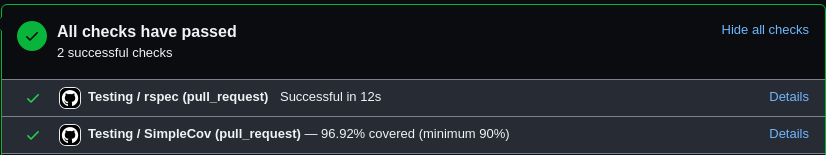

# SimpleCov+ Action

A Github check action which displays failing test coverage from SimpleCov while providing the option
to fail a build based on minimum coverage threshold.



Want to see more examples of this check in action? :wink: See [screenshots.md](/screenshots.md)

## Basic Installation
In order for SimpleCov+ Action to function properly, you first need the simplecov gem. See [Getting Started](https://github.com/simplecov-ruby/simplecov#getting-started).

Assuming you've followed the guide above (you have the gem in your Gemfile and have properly setup test_helper.rb), then the only other step is to utilize the Github action within your workflow.

```yml
  # However you run your tests to generate code coverage
  - name: Run my tests
    run: |
      bundle exec rspec specs/

  # Minimum configuration
  - uses: joshmfrankel/simplecov-check-action@main
    with:
      github_token: ${{ secrets.GITHUB_TOKEN }}
```

## Configuration Options
See [https://github.com/joshmfrankel/simplecov-check-action/blob/main/action.yml](https://github.com/joshmfrankel/simplecov-check-action/blob/main/action.yml) for all available options and their defaults.

Most useful is the **minimum_suite_coverage** option as it allows specification as to the value at which a failure result should be produced.

## Advanced Installation
The advanced installation switches the coverage failing mode from **overall test coverage** to **per file coverage**. This is similar to the `minimum_coverage_by_file` option that SimpleCov provides. See [minimum_coverage_by_file](https://github.com/simplecov-ruby/simplecov#minimum-coverage-by-file)

> [!WARNING]
> SimpleCov 1.x automatically writes `coverage/coverage.json` when it generates the HTML report. When this action detects that native report, it automatically enables per-file checks using the default `minimum_file_coverage` of 70%. This is a breaking behavior change for projects upgrading from SimpleCov 0.x. Set `minimum_file_coverage: 0` in the action configuration to disable per-file failures.

### SimpleCov 1.x

No additional formatter is required. The native `coverage/coverage.json` generated by SimpleCov is detected automatically and its per-file line coverage is checked against `minimum_file_coverage`.

### SimpleCov 0.x

To activate per-file coverage checks with older SimpleCov versions, configure the [simplecov-json](https://github.com/vicentllongo/simplecov-json) gem. Set up both the standard formatter and JSON formatter in your `test_helper.rb` or `spec_helper.rb`:

```ruby
require "simplecov"
require "simplecov-json"
SimpleCov.formatters = SimpleCov::Formatter::MultiFormatter.new([
  SimpleCov::Formatter::HTMLFormatter,
  SimpleCov::Formatter::JSONFormatter
])
SimpleCov.start do
  # your config
end
```

One large benefit to this approach is that your code coverage minimum threshold is less skewed by outlier results. Said best by the SimpleCov documentation:

> You can define the minimum coverage by file percentage expected... This is useful to help ensure coverage is relatively consistent, rather than being skewed by particularly good or bad areas of the code.

## Example configuration

Still struggling to set this up? SimpleCov+ Action utilizes itself within a Github workflow. You can view the workflow and the spec_helper files for a good example of how to configure this check.

[Example Github Workflow](/.github/workflows/testing.yml)

[Example Spec Helper SimpleCov Setup](/specs/spec_helper.rb)

## FAQs

First off there is a `debug` option which prints many of the API calls made to Github. This can be helpful for diagnosing faults in SimpleCov+ Action.

### I don't want to fail coverage on a per-file basis

When a supported coverage JSON report is present, SimpleCov+ Action automatically
fails CI when any file is below `minimum_file_coverage`. This includes native
SimpleCov 1.x reports and reports generated by the `simplecov-json` gem. Disable
per-file failures by setting `minimum_file_coverage` to 0.

### My Code Coverage isn't accurate for Rails parallelize 

Use the following configuration within your test_helper.rb or spec_helper.rb:

```ruby

# inside test_helper.rb or spec_helper.rb
class ActiveSupport::TestCase
  parallelize(workers: :number_of_processors)

  parallelize_setup do |worker|
    SimpleCov.command_name "#{SimpleCov.command_name}-#{worker}"
  end

  parallelize_teardown do
    SimpleCov.result
  end
end
```

Additionally, make sure that your test environment is eager loading your application. This ensures that SimpleCov picks up coverage for all files accurately.

```ruby
# config/environments/test.rb
Rails.application.configure do
  # many more configs...
  
  # Note: ENV["CI"] is set to true by default from Github in the testing environment
  config.eager_load = ENV["CI"].present?
  
  # some more configs...
end
```


## Development Setup

```bash
git clone git@github.com:joshmfrankel/simplecov-check-action.git
cd simplecov-check-action
bundle install
bundle exec rspec specs
```

CI runs the suite against both the legacy SimpleCov 0.22 format and the native SimpleCov 1.x format. Run either dependency set locally with its matrix Gemfile:

```bash
BUNDLE_GEMFILE=gemfiles/simplecov_0_22.gemfile bundle install
BUNDLE_GEMFILE=gemfiles/simplecov_0_22.gemfile bundle exec rspec specs
BUNDLE_GEMFILE=gemfiles/simplecov_1_x.gemfile bundle install
BUNDLE_GEMFILE=gemfiles/simplecov_1_x.gemfile bundle exec rspec specs
```

# Contributing

- Use the Pull Request template
- Describe Why the change is necessary and what is included in the change
- Include screenshots if necessary
- PRs without description will be closed 😬
